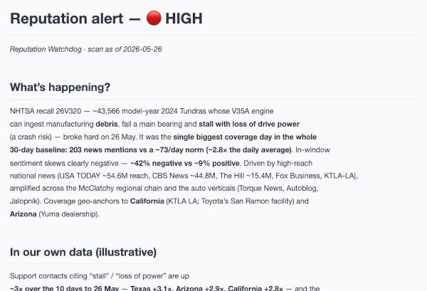

# Reputation Watchdog — a reference agent on Meltwater MCP

> **Draft reference implementation.** Shows how to build your *own* agent that uses **Meltwater
> MCP as one governed source of external signal**, joined with your **own first-party data**, to
> produce an insight neither could alone. Built by your team, running in your infrastructure —
> not a chat in Claude.

A small agent that runs a brand reputation scan: it compares coverage in a window to the ~30-day
norm, flags an anomaly, **cross-references your own systems** for the same signal, and drafts a
fused alert. The worked example in `sample_output/` reproduces the real May-2026 Toyota Tundra
recall re-escalation.



## What it does

| Step | Meltwater MCP tool | What it gets |
|---|---|---|
| Resolve search | a saved-search **list** tool | Proposes the best-matching saved search — grounds on the configured id |
| Volume vs norm | `unified_retrieval_statistics_retrieval_tool` (count by day) | Anomaly-window volume vs the ~30-day baseline → the anomaly + severity |
| Sentiment | `unified_retrieval_statistics_retrieval_tool` (sentiment breakdown) | Negative/neutral/positive split |
| Top sources | `unified_retrieval_statistics_retrieval_tool` (top sources) | Who's driving / amplifying it |
| Headlines | `unified_retrieval_document_retrieval_tool` (sortBy reach) | The key articles in-window |

Then it calls your **first-party source** (here, a mock support-desk MCP server) and **fuses**
both into the alert. The join happens in *your* agent — the thing the Meltwater app can't do.

**Grounding on a saved search:** the scan grounds on a Meltwater **saved search** (`query:"*"`) —
your curated search is the authority on relevance and gives a cleaner dataset than an ad-hoc
query. (No saved search yet? The agent falls back to `unified_retrieval_query_gen_tool` on the
topic name.)

## The fusion architecture

```
   reputation_watchdog.py  (your agent, your infra)
        ├── Meltwater MCP (v2)      → external signal (governed + metered) — bearer token
        ├── your first-party source → your own data (the bundled mock stands in for it)
        └── Anthropic SDK (LLM)     → reasons across both → drafts the alert
```

Both sources are attached as **client-side MCP clients** — your process holds the connections and
executes the tool calls (via the Anthropic SDK tool runner). That's what lets it reach a
**private** internal source without exposing it to the public internet, and it's how you'd wire
in your real systems. (The server-side connector is right for public-only data, but it can't
reach a private source — Anthropic's servers would have to dial into your network.)

## Anchoring the scan: the `--as-of` date

The watchdog compares a 24h window to the ~30-day norm — so **on a quiet day there's nothing
anomalous to show**. Pass `--as-of YYYY-MM-DD` (or set `asOf` in the watch config) to anchor the
scan to a specific day: the "last 24h" becomes the 24h of that day, and the baseline the 30 days
before. Default is today (real-time).

This is a real capability — backfilling a missed run, replaying an incident, or investigating a
past event — not just a demo trick. The windows are computed in code (no fuzzy model date maths),
and **the alert labels the as-of date**, so a backdated run is never mistaken for live.

## Ways to run it

- **In Claude Code (no code) — quickest:** let Claude Code act as the agent using your connected
  Meltwater MCP connector + the bundled mock source. See `RUNNING-IN-CLAUDE-CODE.md`.
- **Standalone (this repo):** `reputation_watchdog.py` runs entirely in your own process — the
  schedulable path. Meltwater auth is a **single seam** (`MELTWATER_API_TOKEN`, bearer token).
- **Later — OAuth:** when Meltwater's per-user OAuth clients land, swap the static token for an
  OAuth credential. Same code, different credential.

## Credentials

1. **An Anthropic API key** — the agent's reasoning ([console.anthropic.com](https://console.anthropic.com) → Settings → API Keys):
   ```bash
   export ANTHROPIC_API_KEY="sk-ant-…"
   ```
2. **A Meltwater MCP API token** — access to your Meltwater data (from your Meltwater account team):
   ```bash
   export MELTWATER_API_TOKEN="…"
   ```

Or put them in `.env` (`cp .env.example .env`). The code never hardcodes a key.

## Quickstart (standalone)

```bash
uv sync                                                # installs anthropic[mcp], mcp, python-dotenv
cp .env.example .env                                   # add ANTHROPIC_API_KEY + MELTWATER_API_TOKEN
uv run python mock_firstparty/server.py &              # start the mock first-party source (localhost)
uv run python reputation_watchdog.py --watch watches/example-watch.json --out brief.md
```

Anchor the scan to a specific day (backfill, replay, or a demo with a known event):

```bash
uv run python reputation_watchdog.py --watch watches/example-watch.json --as-of 2026-05-26
```

See `sample_output/brief.md` for what a real anomaly run looks like — the May 2026 Toyota Tundra
recall (real Meltwater coverage; illustrative first-party figures).

The alert is written to `--out` (default `brief.md`) and printed to the console. To run it
headless, add a delivery step (post to your channel, email it, drop it on a file host).

## Make it your watch

Everything specific lives in one JSON file — fork `watches/example-watch.json`:

- `name` / `brand` — the subject of the scan
- `savedSearch.id` — your Meltwater saved-search id (relevance authority; queried with `query:"*"`)
- `firstParty` — a connector to your real internal system (CRM, support desk, claims…); the
  bundled mock stands in for it
- `regions` — where to look for external/internal agreement
- `windowHours` / `baselineDays` / `asOf` — the anomaly window, baseline, and optional anchor date

Point `WATCH_CONFIG` at your copy (or pass `--watch path/to/watch.json`).

## What's next (documented, not built)

- **Swap the mock for your real system** — an internal MCP endpoint or a plain function tool.
- **Expose it as a sub-agent.** This runs as a *dedicated* agent (Meltwater is its primary
  source, fused with your data in-process). The same scan logic could instead be exposed as a
  **reputation sub-agent** your broader orchestrator calls — with the fusion and the response
  action moving up into the host. Same Meltwater tools, different wiring.
- **Act, don't just alert** — add a step that drafts a holding statement or opens a ticket.

---
*Example data: Meltwater coverage is real (Toyota Tundra recall, 26 May 2026). First-party support
figures are illustrative — they stand in for your own data. No customer PII.*
