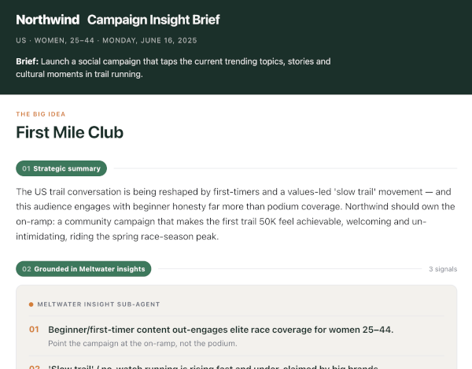

# Social Brief Sub-Agent — a reference agent on Meltwater MCP

> **Draft reference implementation.** Shows how to plug **Meltwater MCP** into your *own* agent
> as a specialist **insight sub-agent**. A marketer asks your agent to shape a social campaign;
> your agent asks the Meltwater sub-agent for a grounded **landscape insight**, then authors the
> campaign **brief** from it. Meltwater supplies the *insight*; your agent does the *creative*.

Most examples show you building a whole agent *on* Meltwater. This one is different: you already
have (or are building) your own agent, and Meltwater slots in as **one source of insight your
agent calls** — alongside your own data and tools. The reusable asset here is **the contract
between the two agents** (see *The contract* below), not the demo brand.



## What it does

```
  MARKETER REQUEST
    ─▶ YOUR ORCHESTRATOR (mock — your own agent; NO Meltwater access)
        ─▶ MELTWATER INSIGHT SUB-AGENT (Claude + Meltwater MCP tools)  ─▶  INSIGHT PAYLOAD
    ─▶ YOUR ORCHESTRATOR authors the CAMPAIGN BRIEF from the insights
    ─▶ RENDER (render.py)  ─▶  brief.html
```

| Step | Who | Meltwater MCP tool | What happens |
|---|---|---|---|
| Resolve search | Meltwater sub-agent | a saved-search **list** tool | Lists your searches, **proposes** the best match — but grounds on the configured id (see *Search resolution*) |
| Shape & mood | Meltwater sub-agent | `unified_retrieval_statistics_retrieval_tool` | Volume trend, sentiment, top sources/themes |
| Driving stories & social | Meltwater sub-agent | `unified_retrieval_document_retrieval_tool` | Highest-reach articles + highest-view posts (`query:"*"`) |
| Synthesise insight | Meltwater sub-agent | — | Trends, cultural moments, notable voices, **whitespace for the brand** |
| Author the brief | Your orchestrator | *(none — no Meltwater access)* | Concepts, formats, hashtags, channels, timing — the creative |

The Meltwater sub-agent reasons over the results and emits a structured **insight payload**. Your
orchestrator turns that into a **campaign brief**, which `render.py` renders to a single flat
HTML file — prints straight to PDF, works in any browser. No bundler, no external fonts, no
client-side JS.

**The division is enforced by architecture:** your orchestrator is handed only the insight
payload — it never sees a Meltwater tool. So Meltwater is unambiguously the *insight source*, and
your agent does the *brief*.

## Why build it this way?

This is the pattern for when you're building your **own** agent platform and want best-of-breed
insight services to plug into it, rather than working inside someone else's agent. Meltwater
becomes a specialist sub-agent your orchestrator delegates media-intelligence tasks to — a deeper
integration than a dashboard, and one your agent composes with your own data.

## The contract (the point of this reference)

**Request in** — what your agent sends the sub-agent:

```json
{ "brand": "Northwind Athletic", "market": "US", "interest_area": "Trail running",
  "audience": "Women, 25–44", "objective": "…", "timeframe": "last 30 days" }
```

**Insight payload out** — what the sub-agent returns (insights only — no concepts/copy/channels):
`landscapeSummary`, `trendingTopics`, `culturalMoments`, `audienceResonance`, `notableVoices`,
`sentimentMood`, `whitespaceForBrand`, `evidenceAppendix`. See `sample_output/sample_insight.json`.

The sub-agent **never writes the brief** — your agent turns the payload into
`sample_output/sample_brief.json`, which renders to the HTML the marketer sees. A run writes both
JSONs next to `brief.html`, so you can inspect both sides of the contract.

## Ways to run it

- **In Claude Code (no code) — quickest:** let Claude Code act as both agents using your connected
  Meltwater MCP connector. See `RUNNING-IN-CLAUDE-CODE.md`. Great for a first look.
- **Standalone (this repo):** `social_brief_subagent.py` runs entirely in your own process — and
  is the piece you'd wire into your real orchestrator. Meltwater auth is a **single seam**
  (`MELTWATER_API_TOKEN`, sent as a bearer token).
- **Later — OAuth:** when Meltwater's per-user OAuth clients are available, swap the static token
  for an OAuth credential. Same code, different credential.

## Credentials

You need two things:

1. **An Anthropic API key** — the agents' reasoning. Create one at
   [console.anthropic.com](https://console.anthropic.com) → **Settings → API Keys**, then:
   ```bash
   export ANTHROPIC_API_KEY="sk-ant-…"
   ```
2. **A Meltwater MCP API token** — access to your Meltwater data (from your Meltwater account team):
   ```bash
   export MELTWATER_API_TOKEN="…"
   ```

Either `export` them or put them in a `.env` file (`cp .env.example .env`) — the script loads
`.env` automatically, and exported vars take precedence. The code never hardcodes a key.

## Quickstart (standalone)

```bash
uv sync                                                      # installs deps (anthropic[mcp], python-dotenv, mcp)
cp .env.example .env                                         # add ANTHROPIC_API_KEY and MELTWATER_API_TOKEN
uv run python social_brief_subagent.py --out brief.html
open brief.html                                              # then "Save as PDF" from the report
```

The run writes three files next to `brief.html`: `brief.insight.json` (what Meltwater returned),
`brief.brief.json` (what your agent produced), and `brief.html` (what the marketer sees).

**Render only** (no Meltwater / no API key — useful for template/design work):

```bash
uv run python render.py sample_output/sample_brief.json --campaign campaigns/example-campaign.json --out sample_output/brief.html
```

See `sample_output/brief.html` for what a finished brief looks like (fictional demo brand).

## Make it your campaign

Everything specific lives in one JSON file — fork `campaigns/example-campaign.json`:

- `brand` / `wordmark` — identity on the brief
- `market` / `interestArea` / `audience.label` / `objective` — the request the sub-agent grounds on
- `savedSearch.id` — your Meltwater **landscape** saved-search id (the wider interest-area
  conversation, **not** your brand mentions; the brand enters only as a whitespace lens)
- `theme` — colours (each maps to a CSS variable `render.py` injects, so you can restyle the
  brief without touching the template)

Point `CAMPAIGN_CONFIG` at your copy (or pass `--campaign path/to/campaign.json`).

### Two things worth knowing

- **Search resolution is a convenience, not the authority.** The sub-agent lists your searches
  and *proposes* the best match for the request, but it grounds on the **configured
  `savedSearch.id`** — a confident-but-wrong auto-pick would silently ground the whole brief on
  the wrong data. Point the config at the search you mean; treat the proposal as a helper.
- **Audience is a lens, not a filter.** Meltwater captures authors/mentions, not the demographics
  of who *reads* content, so "Women, 25–44" shapes how the insight is interpreted — it is not a
  hard data filter.
- **The one query trick:** the sub-agent always pairs `query:"*"` with the saved-search id. The
  saved search is the sole authority on relevance; a descriptive query string alongside it
  triggers a semantic re-rank that suppresses high-reach/high-view posts. `query:"*"` disables
  that so results sort purely by the requested metric. This is baked into the agent's instructions.

## What's next (documented, not built)

- **Hosted skill:** today the Meltwater sub-agent is Claude + the raw retrieval tools + an analyst
  prompt. As Meltwater ships composed skills, you'd swap that for a hosted `get_social_brief` —
  same contract, less code to own.
- **A standing watch:** the flip side of this pattern — a sub-agent that *proactively* surfaces
  on-brand opportunities into your orchestrator (rather than answering on request).
- **Fuse your own first-party data** into the brief (campaign calendar, prior performance) — the
  insight neither source produces alone.

---
*Example data in `sample_output/` is a fictional brand ("Northwind Athletic") with invented
figures. Live runs pull real data from your own Meltwater saved search.*
